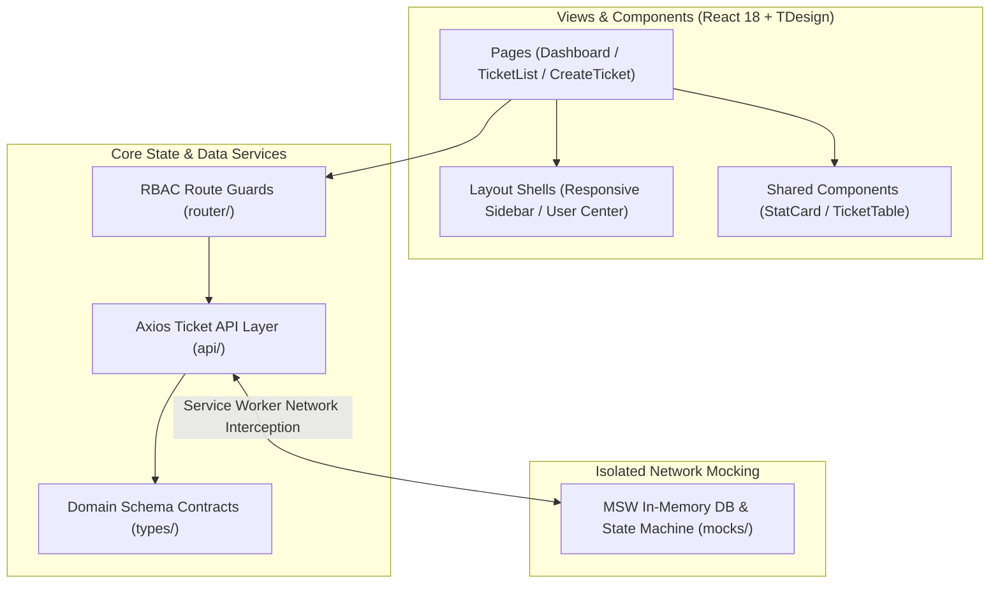

[简体中文](README.md) | English

# Workorder Management System · 工单管理系统

**A modern enterprise ticket workflow, role-based approval, and dispatch platform.**

`workorder-management-system-1` is an enterprise ticket management application handling complete ticket lifecycles from creation and dispatch to approval and resolution. Refactored atop Vite, React 18, and TypeScript, it integrates Tencent TDesign, Apache ECharts, and Capacitor 5. Built-in Mock Service Worker (MSW) mocking eliminates the need for live backend Java servers during local development, while remaining ready for Android mobile deployment.

---

## Core Capabilities

* **Ticket Lifecycle State Machine**:
  * Covers the full lifecycle: draft creation, departmental routing, multi-tier approvals, collaborative re-assignment, and resolution archiving;
  * Immutable timeline tracking recording operator identities, review notes, and timestamps.
* **Role-Based Collaboration Matrix**:
  * **Auditor Role**: Focuses on ticket compliance reviews, approvals, rejections, and milestone clearances;
  * **Dispatcher / Worker Role**: Handles claim acceptance, progress updates, inter-agency delegation, and resolution submission.
* **Telemetry Workspace & Dashboards**:
  * **Operational Metric Cards**: Tracks overdue warning tickets, backlogs, user-created tasks, and resolved volumes;
  * **ECharts Analytics**: Visualizes weekly ticket workloads and turnaround velocity charts.
* **Multi-Platform & Asset Storage**:
  * Built-in Capacitor 5 configuration for one-click Android container builds;
  * Externalized Tencent Cloud COS object storage integration for clean attachment management.

---

## Technical Stack

| Layer | Architecture | Role |
| :--- | :--- | :--- |
| **Foundation** | Vite + React 18 + TypeScript | Modern frontend runtime and type safety |
| **Design System** | Tencent TDesign (React) | Enterprise-grade UI component ecosystem |
| **Analytics** | Apache ECharts | Responsive charts and workload dashboards |
| **Local Mocking** | Mock Service Worker (MSW) | Standalone offline development and testing |
| **Mobile Target** | Capacitor 5 | Native Android compilation container |

---

## Quick Start

### 1. Installation & Initialization

```bash
# Install dependencies
npm install

# Initialize MSW Service Worker assets in public directory
npx msw init public/
```

### 2. Development Server

```bash
npm run dev
```

Navigate to `http://localhost:5174` in your browser.

### 3. Seed Demo Accounts

| Username | Password | Role | Permissions |
| :--- | :--- | :--- | :--- |
| `admin1` | `123456` | Auditor | Final review, approvals, rejections |
| `worker1` | `123456` | Operations Worker | Ticket claiming, task delegation, resolution |

---



* **`api/`**: Axios HTTP client abstraction and ticket REST APIs
* **`components/`**: Reusable UI widgets (StatCard, TicketTable, Audit Modals)
* **`layout/`**: Application shell layout (collapsible responsive sidebar, breadcrumbs, user center)
* **`mocks/`**: MSW in-memory database, transition state machine, and seed collections
* **`pages/`**: Primary route views (Operations Dashboard, Ticket Grid, Ticket Creation, Mobile views)
* **`router/`**: Route tree and RBAC authentication guards
* **`types/`**: TypeScript business schemas, ticket life-cycle states, and roles
* **`data/`**: Administrative cascades, status codes, and enum dictionaries

---

## License

This project is open-sourced under the [MIT License](LICENSE).
